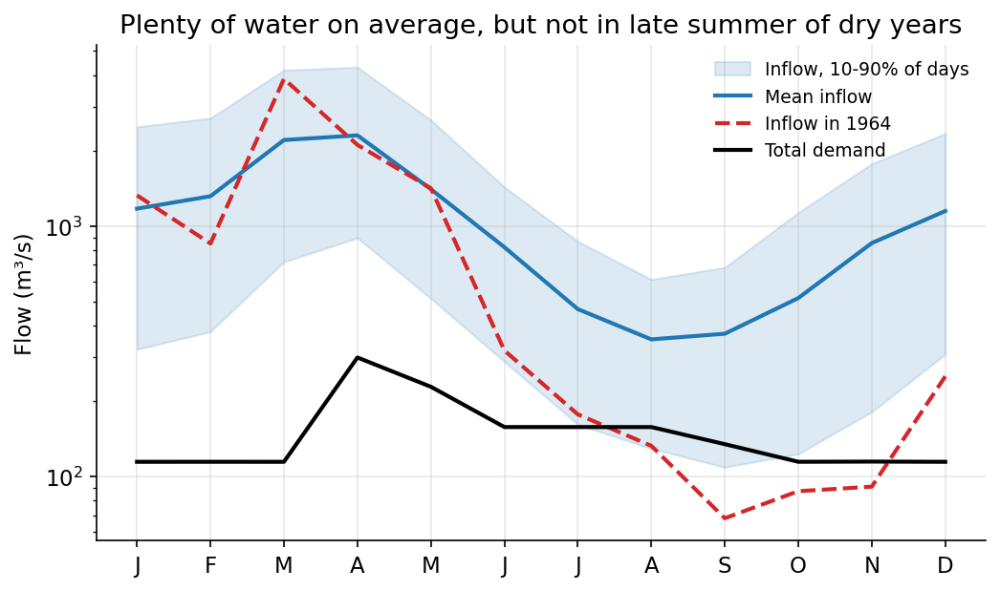
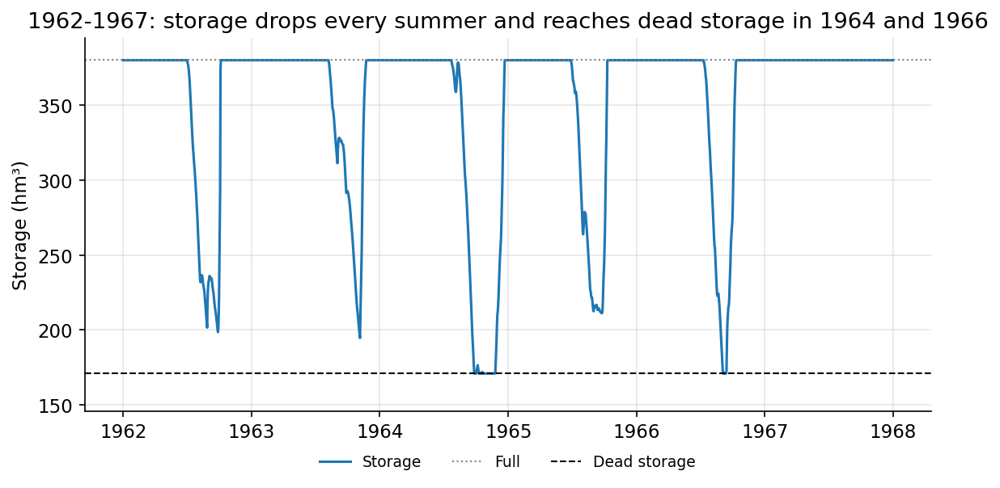
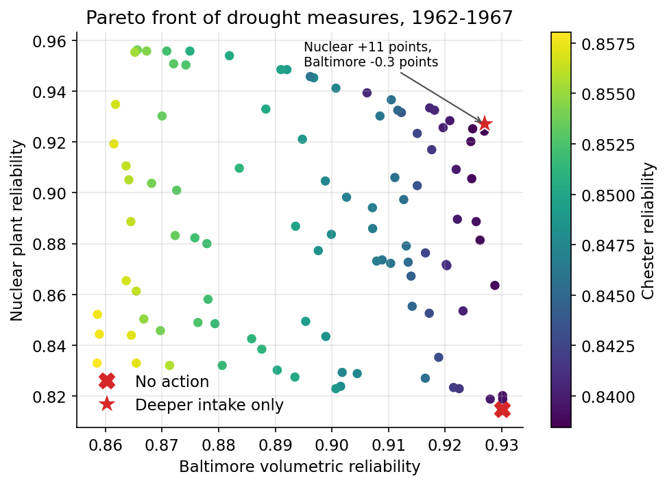
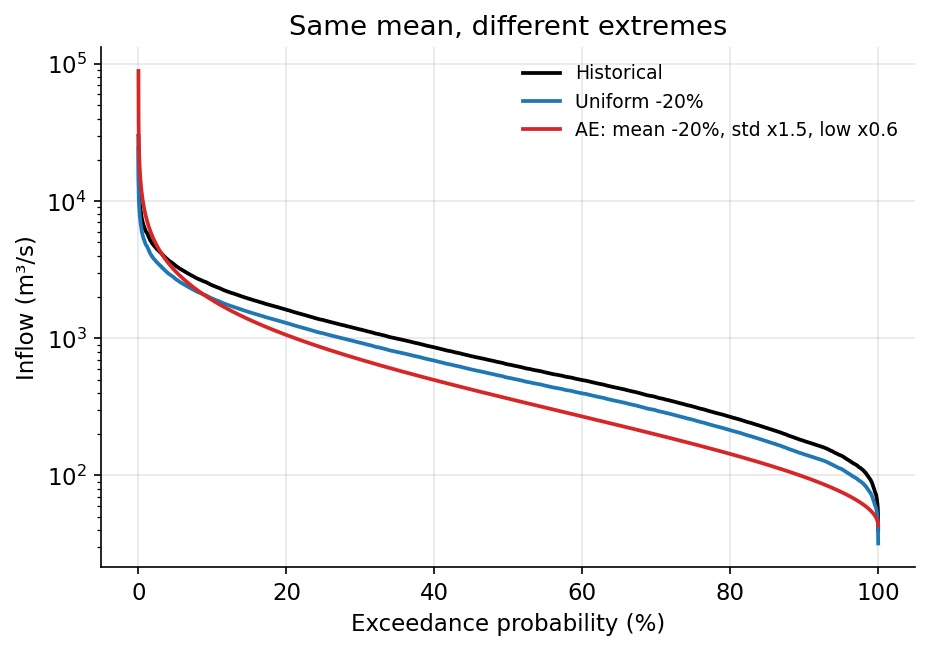
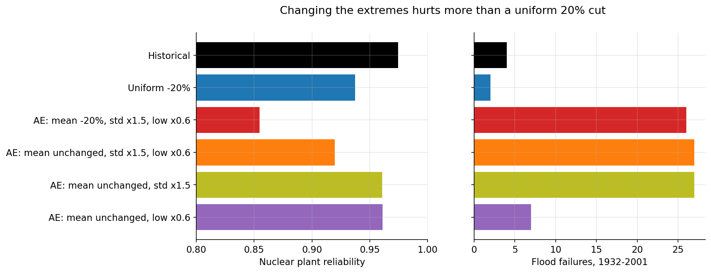
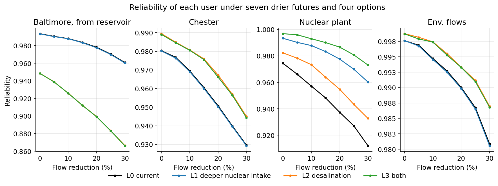

# Conowingo Reservoir: Multi-Objective Operation Under Climate Uncertainty

How reliable is a water supply reservoir today, which drought measures are worth taking, and
how much do the answers change if the climate changes? This project follows these questions for
the **Conowingo reservoir** on the Susquehanna River, which supplies Baltimore, Chester and a
nuclear power plant, and must also meet environmental flows and limit flooding downstream.

The work was done in CE48V, a water resources systems course at Boğaziçi University, in Fall 2026. It uses 70 years of daily
inflow data from 1932 to 2001 and a daily water balance model of the reservoir.

**Methods:** daily water balance simulation · reliability, resilience and vulnerability metrics ·
multi-objective optimisation with NSGA-II · climate scenarios from a flow duration curve model ·
stress testing · regret-based robustness analysis

## 1. The problem is timing, not quantity



On average the river carries **7.1 times** more water than all users need. Still, inflow is below
total demand on **1,254 days, about 5%** of the record, almost all of them from July to October. In
the dry year 1964, inflow falls far below demand from August to November. The reservoir has to
bridge these months, and its usable storage is only **209 hm³**.

## 2. The reservoir is small for its drought



With its standard operating policy the reservoir is full on **93% of days**, but in the 1962-1967
drought it is drawn down every summer and reaches dead storage in 1964 and 1966. Over the full
record, the nuclear plant has the lowest reliability of the three water users, **0.974**, against
0.980 for Chester and 0.994 for Baltimore. Its intake is the shallowest, so it is the first to fail
when the lake level drops.

## 3. Which drought measures are worth it?



I searched three measures with NSGA-II over the 1962-1967 drought: a demand reduction for
Baltimore, the reservoir level that triggers it, and a deeper intake for the nuclear plant. The
100 Pareto-optimal designs show that:

- **The levers separate cleanly.** The intake depth alone drives the nuclear plant, with a Spearman
  correlation of +0.97, and the demand reduction alone drives Baltimore and Chester, at −0.98 and +0.96.
  One design on the front has no demand reduction and only a deeper intake. It raises the
  plant's reliability from 0.815 to 0.924, while Baltimore stays at 0.927 against 0.930 with no
  action. This is close to a free improvement.
- **The real trade-off is Baltimore against Chester**, and it is a poor one. Baltimore's
  reliability spans 7.2 points across the front, but Chester's spans only 2.0.
- **The framing matters.** Without Chester as an objective, only 17 of the 100 designs stay
  non-dominated. Most of the front exists because of a 2-point difference, which suggests treating
  Chester as a constraint instead of an objective.

## 4. A changing climate: the extremes matter more than the mean



I compared two ways of building a drier future. The simple way cuts every flow by 20%. The
Amplified Extremes model also cuts the mean by 20%, but makes flows 50% more variable and low flows
40% lower, which fits what we observe in droughts and floods around the world.



| Scenario | Baltimore | Chester | Nuclear plant | Flood failures |
|---|---|---|---|---|
| Historical | 0.994 | 0.980 | 0.974 | 4 |
| Uniform −20% | 0.978 | 0.951 | 0.937 | 2 |
| Amplified Extremes, mean −20% | 0.918 | 0.874 | 0.855 | 26 |
| Amplified Extremes, mean unchanged | 0.963 | 0.934 | 0.920 | 27 |

- The uniform model hides the problem. It shows mild water stress and even **fewer** floods, so a
  design checked only against it would look safe.
- Even with **no change in the mean**, more variable flows with lower low flows make every user worse
  off than a uniform 20% drier future, and flood failures rise from 4 to 27.
- Changing only the variability or only the low flows lowers the nuclear plant's reliability to about
  0.96. Changing both lowers it to 0.92, so the two effects add up. The extra floods come from the
  higher variability.

**What this means for decisions:** testing designs against the historical record, or against a
simple change in the mean, gives false confidence. Designs should be stress-tested across many
possible futures. That is the next step of this project.

## 5. Which adaptation option is robust?

I tested four options across seven drier futures, with inflows cut by 0 to 30%:
**L0** keeps the current set-up, **L1** lowers the nuclear plant intake to the depth of the Baltimore
intake, **L2** adds a desalination plant that supplies Baltimore whenever the reservoir is not full,
and **L3** combines L1 and L2.



For each future I measured the regret of each option, which is the reliability lost compared with the
best option in that same future. The table shows the worst regret over all seven futures.

| Option | Baltimore, from reservoir | Chester | Nuclear plant | Env. flows |
|---|---|---|---|---|
| L0 current | 0.000 | 0.017 | 0.061 | 0.006 |
| L1 deeper nuclear intake | 0.001 | 0.017 | 0.013 | 0.006 |
| L2 desalination | 0.094 | 0.000 | 0.040 | 0.000 |
| **L3 both** | 0.095 | **0.001** | **0.000** | **0.000** |

- **L3 is the robust choice.** It has zero or almost zero regret for every user except Baltimore.
- **Baltimore's loss is not a real shortage.** Under L2 and L3, its reliability only counts water
  taken from the reservoir, and desalination supplies the rest by design. The same metric means
  different things for different users, so regret tables need care.
- **Options help more than one user.** Desalination also raises the nuclear plant's reliability from
  0.974 to 0.982, because the water Baltimore no longer takes stays in the reservoir. The deeper intake
  alone raises it to 0.993, which agrees with the near free improvement found in Section 3.
- **Hydropower depends on the climate, not on the options.** A 30% flow cut lowers it from 2,064 to
  1,582 GWh per year, but the options change it by less than 0.2%.

**Limits:** these futures only cut flows uniformly, and Section 4 showed that this underestimates the
risk, so the regrets here are likely optimistic. The analysis also ignores the cost and energy use of
desalination, and seven futures without probabilities cannot say how likely each outcome is.

## Next step

Repeat the robustness test with Amplified Extremes futures instead of uniform cuts, and use scenario
discovery to find the conditions under which each option fails.

## Who did what

| Part | Source |
|---|---|
| Reservoir model, water balance, performance metrics, flow duration curve model, data | Course material, not included in this repository |
| Analysis, interpretation and all findings above | Mine |
| Scripts in `analysis/` that rebuild every figure and table | Mine |
| The NSGA-II run in `results/pareto_front_nsga2.csv` and its analysis | Mine, run with the course optimisation set-up |
| The scenarios that separate the variability and low-flow effects | Mine, built on top of the course climate model |
| The robustness test in Section 5 | Course set-up of futures and options; my own script, regret summary and interpretation |

## Reproducing the results

The course model and data are not mine to share, so they are not in this repository. With access
to the course folder:

```bash
conda activate <your environment>   # pandas, numpy, scipy, matplotlib, openpyxl
export CE48V_COURSE_DIR=/path/to/course/tutorials
cd analysis
python 01_inflow_vs_demand.py
python 02_drought_storage.py
python 03_pareto_front.py
python 04_climate_scenarios.py
python 05_robustness.py
```

Figures go to `figures/` and tables to `results/`. `03_pareto_front.py` reads the saved NSGA-II
front instead of re-running the optimisation, because NSGA-II is stochastic and a new run would
shift every number.

## References

- Zatarain Salazar et al. (2016), source of the Conowingo system description used in the course.
- Yildiz et al. (2023), *Hydrology and Earth System Sciences*, 27, 2499, the flow duration curve
  model behind the Amplified Extremes scenarios: https://hess.copernicus.org/articles/27/2499/2023/
